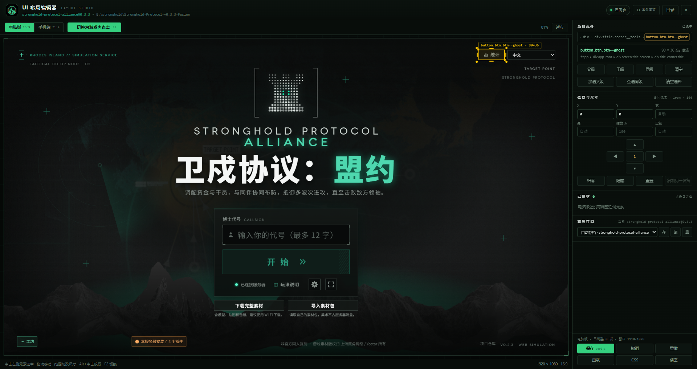
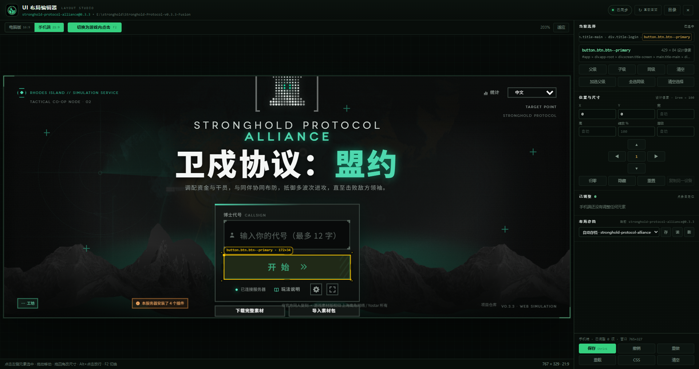

因为手机端适配通过调教AI太痛苦了，于是我让AI自己做了个UI编辑器。

# Stronghold-UI-Editor

> 《民间卫戍协议：盟约》UI 布局编辑器（**民间同人二创**，非官方作品） —— 内置浏览器里左侧看游戏画面、右侧调界面，**实时**拖拽 / 缩放 / 换图，保存后普通开局也生效。




> **1.2.1 新增**：**母集**——把元素打包成整体，整组移动、整组等比缩放（大小与位置同比例）、成员随时移出、母集可删、边界跟着子元素走，还能贴住屏幕边保持固定像素。
>
> **1.1.1 新增**：① 拖动 / 缩放时**边缘吸附 + 对齐参考线**；② **UI 间边距固定**（换比例也不走位）；③ 目录选择页**整行绿色高亮**符合条件的文件夹。逐条说明见 [UPDATE.md](UPDATE.md)。

---

## ✨ 特点一览

| 能力 | 说明 |
| --- | --- |
| **适配大多数游戏版本** | 只操作 DOM，不依赖服务端接口；`server/index.js`、`server/index.mjs`、`server/main.js`、`package.json` 的 `main` 都能启动；旧版 `data/ui-layout.json` 自动迁移 |
| **完全不改游戏代码** | 只新增 `public/ui-editor/`、`public/ui-layout.json`，并在 `index.html` 末尾插一行 `<script>`；原文件备份为 `index.html.ui-editor.orig`，随时可还原 |
| **内置浏览器** | 自带 WebView2 宿主（C# 单文件 exe，无需安装 .NET/依赖），不再用系统浏览器 |
| **左右分栏布局** | 左侧大画面实时预览，右侧侧边栏调参数，**没有悬浮窗遮挡** |
| **固定画幅预览** | 电脑端 **1920×1080（16:9）**、手机端 **767×329（21:9）**，按设计分辨率渲染再等比缩放，文字清晰 |
| **所见即所得** | 点击选中、拖动移动、四角四边 8 个手柄自由缩放、双击选父级、方向键微调（长按连发） |
| **母集（元素打包）** | 选中元素 →「建母集」：拖任意成员整组平移、拖手柄整组**等比缩放**（成员位置与大小同比例）；成员可「移出」，母集可「删」，母集边界每帧按成员并集重算，子元素一动边界就跟着动 |
| **母集 / 元素贴边** | 母集或元素可以贴住屏幕某条边，保持**当前像素距离**；换分辨率 / 换比例后整体平移着维持这段距离，间距可精确改 |
| **边缘吸附 + 参考线** | 拖动的边自动吸到屏幕左中右 / 上中下、父级和同级元素的边，命中时画青色虚线；`Alt` 临时关闭，吸附范围 4 / 8 / 14 px 可切 |
| **UI 间边距固定** | 选两个元素 → 「固定边距」，两者的间距被焊死：换比例、换分辨率、参照元素被游戏挪走，被锁元素都跟着保持间距；拖被锁元素等于改间距 |
| **多选批量** | 多选模式下整组移动、整组等比缩放；关闭多选自动取消选择；按住 Shift 也能临时多选 |
| **图片替换 UI** | 选中任意元素 → 选图片 → **替换原样式**或**覆盖在上层**，支持铺满裁剪 / 完整显示 / 拉伸 |
| **UI 构成分析** | 一键看清元素是 ``、`<svg>`、`Canvas` 还是纯 CSS 画的，告诉你该用哪种替换方式 |
| **一键截图** | 只截游戏画面（自动隐藏选框和侧边栏），**自动复制到剪贴板**，方便发图 |
| **两端方案分开存** | 电脑版 / 手机端各自一套布局，切设备自动套用，互不干扰 |
| **多份存档** | 按游戏版本自动建存档，可另存多份、随时读回；整个 `profiles\` 换机器可带走 |
| **多版本共存** | 选中目录单独起服务端：3000 被占用就自动 3001、3002…，代理 3123 起顺延，不影响已运行的游戏 |
| **目录页更醒目** | 选目录时把检测到是游戏目录的文件夹**整行绿色高亮**并置顶，`GAME + NODE` 的再标「可载入」，一眼就知道该点哪个 |
| **低占用** | 纯 DOM + 一段覆盖 CSS，编辑时不跑逐帧重排；预览按固定画幅渲染 |

---

## 🚀 快速开始

1. 下载 [Release](../../releases) 里的 `Stronghold-UI-Editor-ImageUI-*.zip`，解压到任意位置（建议和游戏目录放同级）。
2. 双击 **`Start.bat`**。
3. 在**内置的目录选择页**里点选游戏根目录（含 `public\`、`server\` 的那一层），按「载入并打开编辑器」。
4. 左侧出现游戏画面后：
   - 点元素选中 → 拖动 / 拖手柄 / 右侧改数值；
   - 拖动时会自动吸附屏幕中线、父级和同级元素的边，按 `Alt` 可临时关掉吸附做精修；
   - 先点参照元素、再 `Shift+点击` 目标元素，点「固定边距」可让两者间距在换比例后保持不变；
   - 想把几个元素打包：选中它们 → 右侧「母集」里点「建母集」，之后拖任意成员就是整组移动、拖四角就是整组等比缩放；`Ctrl+点击`（或成员列表）可以只选中其中一个，再点「移出」让它离开母集；
   - 「贴边」让母集 / 元素贴住屏幕边并保持当前像素距离，换分辨率也不跑位；
   - 右侧「图片替换」可把元素换成图片；
   - `Ctrl+S` 保存，普通开局也会生效。

> 快捷键：`Tab` 切换「UI 编辑 ↔ 游戏内点击」，`Shift` 临时多选，`Ctrl+点击` 只选中母集里的单个成员，`Alt+点击` 放行一次点击，`Alt+拖动` 精细移动（0.1 设计像素且不吸附），`Ctrl+Z / Ctrl+Y` 撤销重做。
>
> 每个版本改了什么见 **[UPDATE.md](UPDATE.md)**；项目地址：<https://github.com/wisadel429/Stronghold-UI-Editor-ImageUI>。

### 运行环境

- Windows 10 / 11（x64）
- **WebView2 运行时**：按顺序自动找 —— ① 工具目录 `webview2\`（放了就优先）→ ② 上次 / 附近检测到的**游戏目录里的 `webview2\`** → ③ 系统 Evergreen 运行时（保证「选目录」的前置页面能先打开）
- **Node.js 22+**：优先用所选游戏自带的 `node\node.exe`

---

## 🖼 界面

| 电脑版 16:9 | 手机端 21:9 |
| --- | --- |
|  |  |

---

## 🧩 游戏 UI 是由什么构成的

工具里的「构成分析」会直接给出答案，结论先写在这里：

| 部分 | 实现 | 能否图片替换 |
| --- | --- | --- |
| 界面框架 / 按钮 / 标题 | Preact 渲染的 DOM + CSS（渐变、边框、`::before` / `::after` 装饰层） | ✅ 最适合 |
| 图标、徽记 | 内联 `<svg>` | ✅ 替换容器背景 |
| 背景、立绘 | ``（如 `/assets/.../ui/entry/bkg_01.png`） | ✅ 直接替换 |
| 战场 | `<canvas>`（PIXI） | ❌ 无效 |

所以图片替换按**元素**逐个做：按钮、图标、标题效果最好。

### 两种替换模式

- **替换原样式**：图片铺满元素，隐藏原文字 / 图标 / 伪元素装饰并去掉边框（按钮、图标首选）。
- **覆盖在上层**：图片以 `::after` 盖上去，原样式和点击都保留（带复杂动效的部件首选）。

图片按内容哈希存到 `<游戏目录>\public\ui-editor\images\skin-<hash>.<ext>`，布局里只记相对路径，普通开局也能显示。

---

## 📦 目录结构

```
Stronghold-UI-Editor/
  Start.bat                 双击入口
  StrongholdUIEditor.exe    WebView2 宿主（窗口 / 选目录页 / 编辑台）
  launch.ps1                备用启动器（--external 走系统浏览器）
  app.mjs                   主程序：校验 / 安装 / 服务端 / 代理 / 事件
  proxy.mjs                 反向代理 + 布局 / 存档 / 图片 / 元信息接口
  build-host.ps1            重新编译宿主（Windows 自带 csc，无需 VS）
  package.ps1               一键打包到 ..\dist\
  UPDATE.md                 每个版本相对上一版改了什么
  host/
    EditorHost.cs           宿主源码
    lib/                    WebView2 SDK
    web/                    内置「选择游戏目录」页
  assets/                   拷进游戏 public/ui-editor/ 的前端
  profiles/                 布局存档
```

## 🛠 从源码构建

```powershell
# 重新编译宿主（需要 Windows 自带的 .NET Framework 4.x）
powershell -ExecutionPolicy Bypass -File build-host.ps1

# 打成可分发 zip（输出到 ..\dist\）
powershell -ExecutionPolicy Bypass -File package.ps1
```

## ❓ 常见问题

**提示「不是游戏目录」** → 要选含 `public\index.html` 和 `server\` 的那一层。

**没有找到 Node.js** → 游戏包一般自带 `node\node.exe`；否则装 Node.js 22+。

**端口被占用** → 服务端自动 3001、3002…，代理自动 3124…；也可 `app.mjs --embedded --game "D:\...\game" --port 3000 --proxy-port 3123`。

**保存报错 / 显示「接口未安装」** → 必须用 `Start.bat` 进入（走编辑代理），不要直接开 `http://127.0.0.1:3000`。

**想彻底卸载** → 用 `index.html.ui-editor.orig` 还原 `index.html`，删掉 `public/ui-editor/` 和 `public/ui-layout.json`。

---

## ⚠️ 说明

- 非官方同人工具，**禁止商用**，与鹰角网络无关，游戏素材版权归原权利人。
- 本工具不修改游戏服务端与源码，只新增编辑器资源与布局文件，全部可逆。
- 图片替换仅影响客户端显示，**不会**改变对局逻辑。
