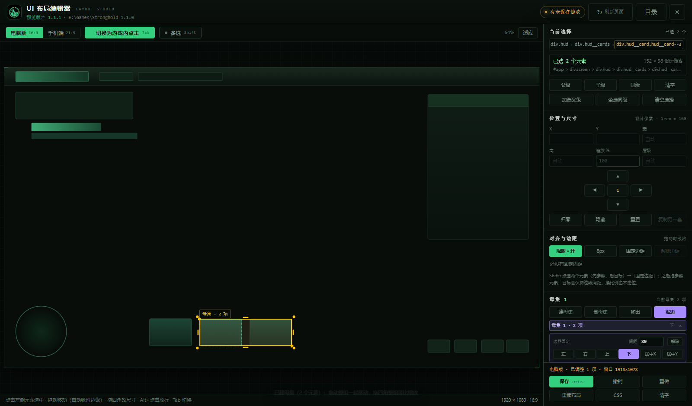
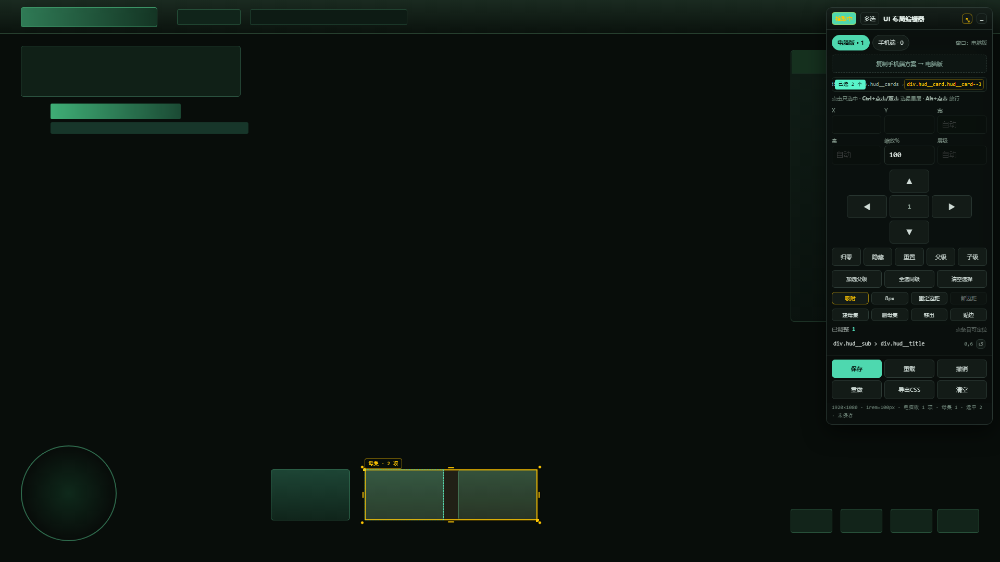
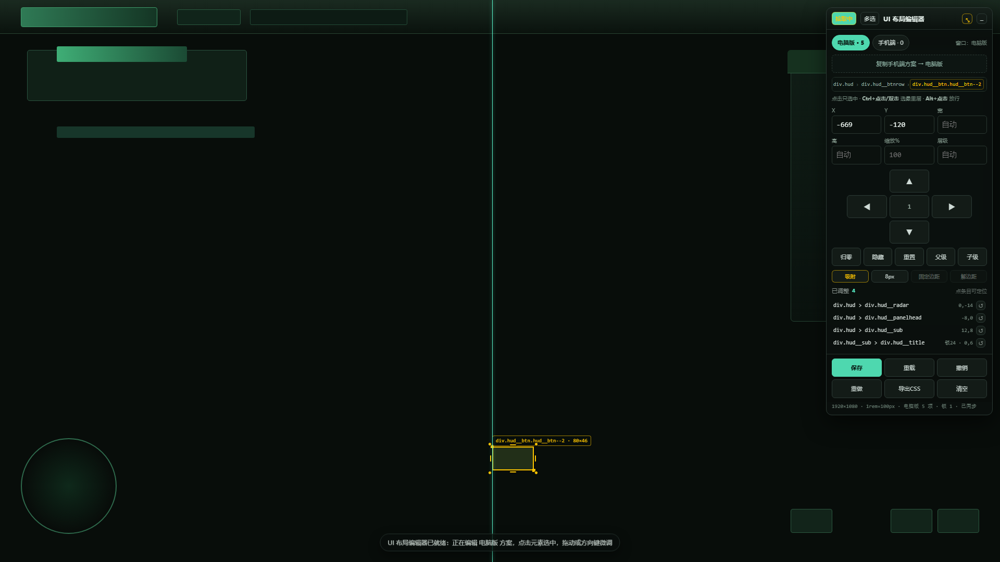
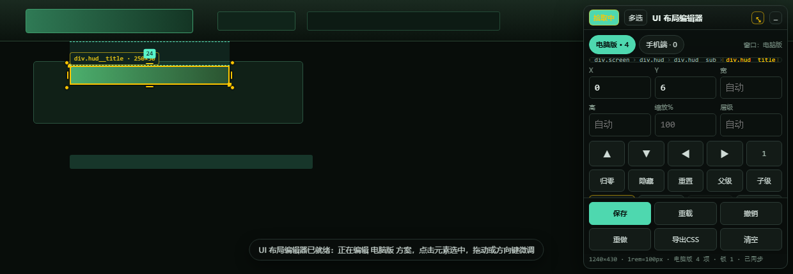
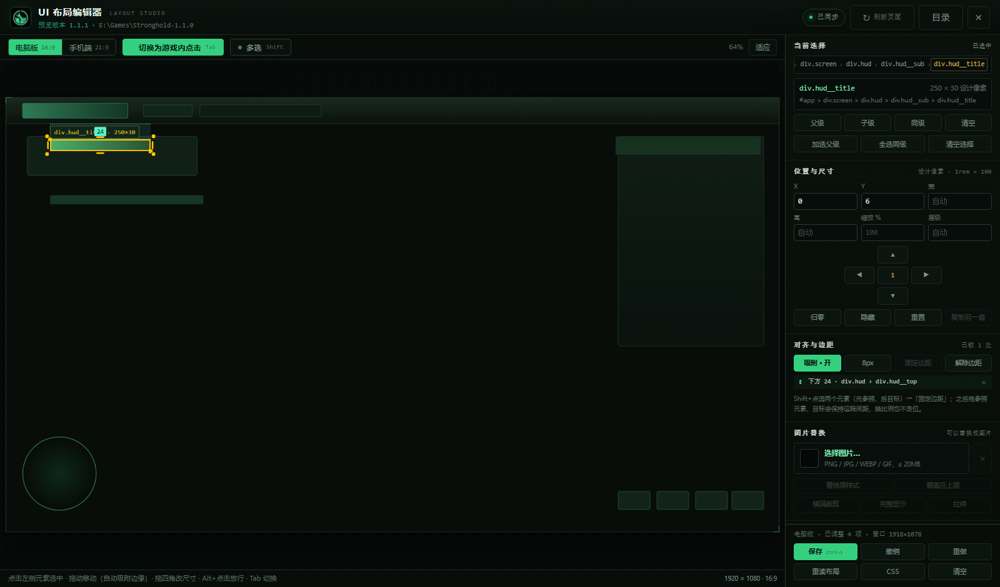
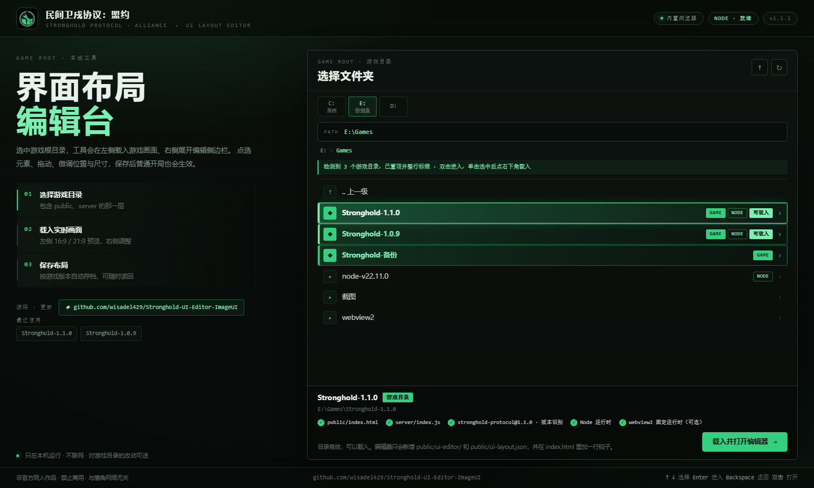

# 更新记录 · UPDATE

本文件跟着版本走，记录每一版**相对上一版**多了什么、改了什么、要注意什么。
当前版本：**1.2.1**（对应压缩包 `Stronghold-UI-Editor-ImageUI-1.2.1`）

---

## 1.2.1（本版）

本版围绕「**母集**」——把若干元素打包成一个编辑单位。五个能力都是独立可用的，也可以组合。

### 一、把元素挪出母集

- 选中母集里的**某一个**成员（`Ctrl+点击`、或在侧边栏「母集」的成员列表里点它），点「移出」即可脱离母集；
- 移出后**位置保持不变**，之后可以单独拖动 / 缩放 / 加自己的锚定，不会再跟着母集走；
- 母集被搬空时会自动删除（提示里会说明），不会留下一个空壳。

### 二、创建母集 · 组内同比例伸缩 · 整组跟随移动

- **建母集**：选中一个或多个元素 → 「建母集」。母集里的元素从此是一个整体：
  - 拖母集内任意一个元素 = **整组平移**（组内相对位置不变）；
  - 拖母集选框的四角 / 四边 = **整组等比缩放**：每个成员的 `scale` 同步乘同一个倍率，各自的 X / Y 也相对固定点（对侧角 / 边）按同一倍率移动，所以“大小与位置同比例”，不会出现有的放大有的没动；
  - 方向键 / 触摸方向键 / 数值输入同样按整组生效。
- 选中母集时选框套在**整组并集**上，标签写着「母集 · N 项」；只选中成员时，会用紫色虚线框标出它所属母集的实时边界。

### 三、删除母集

- 「删母集」只删分组关系，成员的元素调整（位置 / 尺寸 / 缩放 / 图片）原样保留，之后可以单独编辑；
- 侧边栏母集列表里每行右侧的 `×` 也能删（带确认）。

### 四、与屏幕边界保持固定像素

- 选中母集 → 「贴边」自动贴住**最近的一条边**，再点一次解除；侧边栏可以精确选 `左 / 右 / 上 / 下 / 居中X / 居中Y`；
- 贴边记录的是**当前像素距离**（可填「间距」精确改），运行时按实测矩形反算，所以换分辨率 / 换比例后母集会整体平移着保持这段距离；
- 没建母集的单个元素也能贴边（相当于给元素加一条 `to: "@screen"` 的锚定），多个元素可以各自贴各自的边；
- 手动拖动已贴边的母集 = 改这段距离，松手时自动记下新值，不会弹回原处。

### 五、母集边界跟随子元素

- 母集**不存自己的坐标**：边界每帧按成员的实测矩形求并集，所以成员一动 / 一缩放，边界立刻跟着变；
- 因此「贴边」贴的是**当前这个并集矩形**：组里某个成员变宽、变高，母集会整体动到新的位置去维持与边界的距离。





### 数据与兼容

- 布局文件版本 3 → 4，新增 `profiles.<设备>.groups`：

  ```json
  {
    "id": "g1xk2a9",
    "name": "母集 1",
    "members": ["#app > … > div.hud__card--2", "#app > … > div.hud__card--3"],
    "edges": [{ "side": "bottom", "gap": 40 }]
  }
  ```

  旧文件（v1 / v2 / v3）照常读，缺 `groups` 按空处理；一个元素只能属于一个母集，重复的成员按先出现的母集算。
- `proxy.mjs` 的保存白名单同步放行 `groups` 与 `@screen` 锚定，否则保存时会被洗掉。
- 顺手修掉一个老问题：`endResize` 先把 `state.resize` 清空再调用 `applyResize()`，导致**松手前最后一帧可能没落盘**（拖动没这个问题，因为传了对象）。现在缩放收尾会把快照显式传进去。

---

## 1.1.1

### 一、拖动时边缘吸附（对齐参考线）

拖动 / 缩放元素时，被拖动的边会自动吸到附近的参考线上，吸住的一瞬间画一条青色虚线：

- **吸附目标**：屏幕左 / 中 / 右、上 / 中 / 下，加上元素父级和**同级元素**的左中右、上中下三线；
- **吸附范围**：默认 8 屏幕像素，点侧边栏的 `8px` 按钮可在 **4 / 8 / 14** 之间切换；
- **临时关闭**：拖动时按住 `Alt`（此时步长也变成 0.1 设计像素，用于精修）；
- **开关**：侧边栏「对齐与边距」里的“吸附”按钮，状态记在本地，下次打开保持；
- 拖动多选整组时按**并组矩形**的左 / 中 / 右、上 / 中 / 下判断；缩放手柄只吸附“正在被拖的那一条边”。

> 为什么有用：之前只能靠眼睛对齐，或者反复用方向键数像素；现在靠近就自动贴齐，配合参考线可以确认是屏幕中线还是隔壁元素的那条边。



### 二、UI 间边距固定

布局模型新增 `anchors`（边距锁定）——把两个元素的间距“焊死”，换比例 / 换分辨率也不走位：

```json
{ "selector": "被锁元素", "to": "参照元素", "side": "below|above|right|left", "gap": 24 }
```

- **怎么用**：先点参照元素，按住 `Shift` 点目标元素，再点「固定边距」；一次可以锁多个（第一个是参照，其余都锁到它）。
- **怎么生效**：运行时按**实测 rect** 反算还需要补多少位移，所以在真实手机（19.5:9、20:9 等）上，参照元素被游戏自己挪走后，被锁元素会跟着走，间距不变。
- **拖动参照元素**：被锁元素同步跟随；**拖动被锁元素**：等于修改这段间距（松手时自动把新间距记下来，不会弹回去）。
- **视觉反馈**：选中被锁元素时，两元素之间会出现虚线示意带并标出间距数值；侧边栏列出所有锁定关系（`↕ 下方 24 · div.hud > div.hud__top`），点 × 即解除。
- **解除不跳位**：解除时会把当前的补偿量并进 X/Y，元素停在原地。
- 兼容：老布局文件读进来自动补空 `anchors`；布局版本号 2 → 3，`proxy.mjs` 的白名单同步放行新字段，否则保存时会被洗掉。





### 三、文件夹选择界面：符合条件的整行绿色高亮

- 检测到是**游戏目录**的文件夹，不再只染左边那个小图标，而是**整行**绿色高亮（渐变底 + 绿色描边 + 绿色名称 + 左侧亮条）；
- 进一步细分：`GAME + NODE`（能直接载入）额外显示 **可载入** 徽标、左条更亮；只有 `GAME`（缺 Node）保持绿色但不标“可载入”；
- 列表上方新增一条提示：「检测到 N 个游戏目录，已置顶并整行标绿 · 双击进入，单击选中后点右下角载入」；这一层没有游戏目录时提示往上找；
- 鼠标悬停 / 选中态在绿色底上继续加强，不会和普通行的灰蓝高亮混淆。



### 四、其他

- **仓库地址**：目录页左侧说明区和底栏都放了项目地址 `github.com/wisadel429/Stronghold-UI-Editor-ImageUI`，点击用系统浏览器打开（走宿主的 `NewWindowRequested`，不会把编辑页顶掉）。
- **数值不再和画面对不上**：手拖 / 缩放 / 输入 X、Y 之前，会先把“边距固定”的补偿量并进该元素的 X/Y，所以侧边栏里的数字就是屏幕上看到的位置。
- **清空 / 重置 / 归零**：会同时解除相关元素的边距锁定（否则清空后它们还会被锚点拽着）。
- **复制另一套设备方案**：连同锁定关系一起复制。
- 「已调整」列表里，被锁定的条目会显示 `锁24` 这样的标记。

### 五、升级注意

- 布局文件版本从 2 → 3，**旧文件可直接读**（缺 `anchors` 按空处理），新旧工具都读得懂条目；
- `assets/` 里的前端会在下次启动时自动覆盖到 `public/ui-editor/`，不需要手动删旧文件；
- 目录选择页（`host/web/`）是宿主从磁盘直接加载的，**不需要重新编译 exe**。

---

## 1.1.0-ImageUI（上一版）

- 图片替换：选中元素 → 选图片 → 「替换原样式 / 覆盖在上层」+ 铺满裁剪 / 完整显示 / 拉伸；
- UI 构成分析：告诉你元素是 `` / `<svg>` / Canvas 还是纯 CSS；
- 图片按内容哈希存 `public/ui-editor/images/`，布局只记相对路径。
